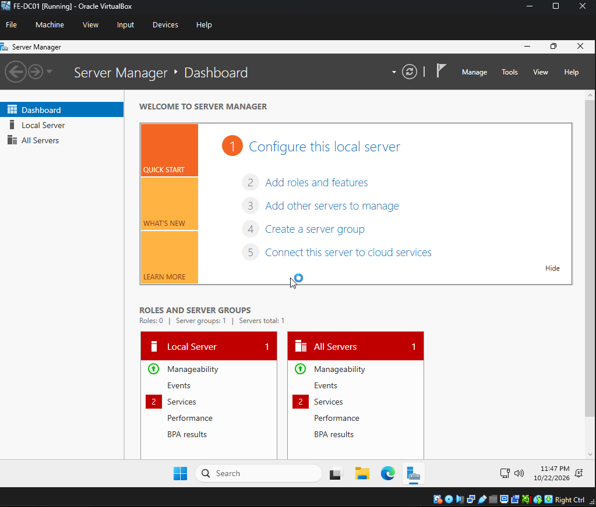

# Lab 01 — Virtualization & Windows Server Foundations

## Objective

Prepare the virtual infrastructure for Fring Enterprises' first Windows Server, FE-DC01.

## Concepts Learned

**Server:** A computer or software service that provides resources to other devices over a network.

**Virtual Machine:** A software-based computer running its own operating system using resources provided by a physical host.

**Hypervisor:** Software that creates and manages virtual machines.

**ISO:** A disk image file commonly used to distribute operating system installers.

**Domain Controller:** A server running Active Directory Domain Services that provides directory and authentication services for a Windows domain.

## Lab Environment

- Host OS: Windows
- Processor: AMD Ryzen 7 9800X3D
- RAM: 32 GB or more
- Virtualization: Enabled
- Hypervisor: Oracle VirtualBox (planned)
- Guest OS: Windows Server 2025 Evaluation (planned)
- VM Name: FE-DC01

## Progress

- [x] GitHub repository created
- [x] VirtualBox installed and verified
- [x] Windows Server 2025 ISO downloaded
- [ ] FE-DC01 virtual machine created
- [ ] Windows Server installed
- [ ] Server configuration verified

## Installation Media

- Operating System: Windows Server 2025 Evaluation
- Architecture: x64
- Installation Type: ISO
- Storage Location: C:\IT-Labs\ISOs
- Purpose: Install Windows Server on FE-DC01

## Concepts Learned

### What is an ISO?

An ISO is a disk image file that can contain an operating
system installer. VirtualBox mounts it as a virtual DVD.

### Why use Windows Server?

Windows Server provides services that other computers
and users in an organization can depend on.

### Why keep installation media outside GitHub?

ISO files are large binary files. Our repository should
contain documentation, configuration examples, and
sanitized screenshots rather than installation media.

## FE-DC01 Virtual Machine Deployment

### Objective
Create and install the first Windows Server VM for
Fring Enterprises.

### Configuration
- VM Name: FE-DC01
- Operating System: Windows Server 2025 Evaluation
- Hypervisor: Oracle VirtualBox
- Virtual CPUs: 2
- RAM: 6144 MB
- Virtual Disk: 80 GB (dynamically allocated)
- Firmware: EFI
- Initial Network: NAT

### Procedure
1. Created a new virtual machine in VirtualBox.
2. Mounted the Windows Server 2025 ISO.
3. Allocated virtual CPU, memory, and storage.
4. Configured NAT networking.
5. Installed Windows Server with Desktop Experience.
6. Verified successful startup.

### Concepts Learned
- vCPU: Processing resources assigned to a VM.
- RAM: Temporary memory used by running programs.
- Virtual Disk: Storage presented to the guest OS.
- EFI: Firmware interface used during startup.
- NAT: A method for translating network addresses.

### Verification
- [ ] VM created successfully
- [ ] Windows Server installation completed
- [ ] Server desktop accessible
- [ ] Screenshot captured

### Evidence

### Next Steps
- Configure the Windows computer name
- Design the isolated lab network
- Configure a static IP address
- Learn DNS and Active Directory fundamentals

## Notes

This is an isolated educational lab. No production systems or employer infrastructure are involved.